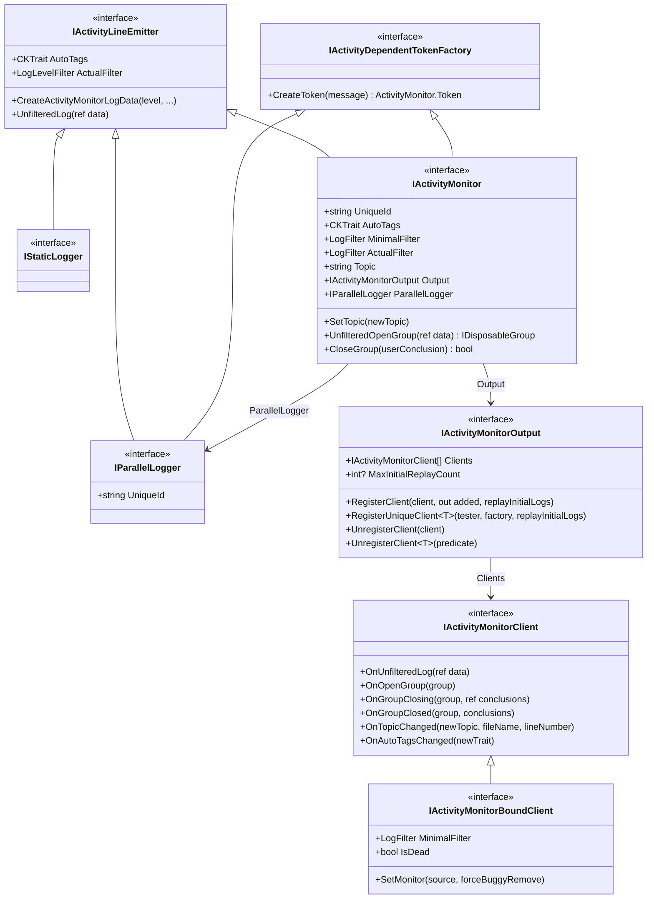

# ActivityMonitor implementation & design
---
**Note**

The ActivityMonitor is a different logger. Its motivation is to support structured logs ("structured" not in the sense of [SeriLog](https://serilog.net/), but structured as a book can be, with Sections, Parts, Chapters, Paragraphs etc.).
This is an opinionated framework: one strong belief is that **logging is NOT a "cross-cutting concern"** (I know how much this could hurt a lot of architects). Logging is the developer's voice, designing logs is an important mission of the developer: logs
must describe the program *by* its execution, they tell the story of the running code, they play a crucial role
in the maintenance, exploitation and evolution phase of any serious project.

The ActivityMonitor is more a **Storyteller**, than a regular Logger.

We believe that more and more architectures, tools, programs will take this path because it's one of the mean to handle high complexity.
MSBuild has this https://msbuildlog.com/, CI/CD interfaces starts to display toggled section around the execution steps, etc.

---


## No AmbientContext

The design of this library is all about fighting the implicit "Ambient Context" that too many libraries use (the worst word
in this sentence being **implicit**).

A `IActivityMonitor` follows the current executing context: it appears as a parameter in a lot of methods.
This is clearly an API pollution. Yes... but this is the only way to be explicit and not rely on implicit context.

An Implicit (also named Ambient) Context requires specific mechanism to be able to "follow the code path".
There is basically two such mechanisms: TLS and AsyncLocal.

### Thread Local Storage (good old synchronous world)

This one is easy, safe, and rather efficient. [Wikipedia](https://en.wikipedia.org/wiki/Thread-local_storage) explains
it well. In C#, this is as simple as using the [ThreadStatic attribute](https://learn.microsoft.com/en-us/dotnet/api/system.threadstaticattribute)
Numerous historical logging framework used this to enrich the logs with contextual information, to structure the logs (by
opening "scopes"). This was easy, lock-free by design and "magical".

Unfortunately this cannot be used as soon as the code enter the asynchronous world, for the same reason as
why a [classical lock doesn't support await](AsyncLock.md).

### The AsyncLocal in the asynchronous world

The [async locals](https://docs.microsoft.com/en-us/dotnet/api/system.threading.asynclocal-1) is functionally equivalent
to thread static in the asynchronous world.

Unfortunately, this is much more complex and less efficient than TLS: the information that must "follow the code" is
encapsulated in an `ExecutionContext`, a kind of associative map whose implementation is deeply rooted in the framework.
Below a piece of [source](https://source.dot.net/#System.Private.CoreLib/src/runtime/src/libraries/System.Private.CoreLib/src/System/Threading/AsyncLocal.cs):
```c#
    /// <summary>
    /// Interface used to store an IAsyncLocal => object mapping in ExecutionContext.
    /// Implementations are specialized based on the number of elements in the immutable
    /// map in order to minimize memory consumption and look-up times.
    /// </summary>
    internal interface IAsyncLocalValueMap
    {
        bool TryGetValue(IAsyncLocal key, out object? value);
        IAsyncLocalValueMap Set(IAsyncLocal key, object? value, bool treatNullValueAsNonexistent);
    }
```
Contrary to the `SynchronizationContext`, suppressing the flowing of this context is not as easy as calling `ConfigureAwait(false)`
because since "some code somewhere" may need this hidden context, it is considered too dangerous to be exposed (it can
still be [suppressed](https://learn.microsoft.com/en-us/dotnet/api/system.threading.executioncontext.suppressflow)).

The good news is that as long as this context is not used (ideally remains empty), the overhead is rather small. But
overusing `AsyncLocal<T>` will definitely cost.

To understand difference (and unfortunate coupling) between ExecutionContext and SynchronizationContext, read [this post from Stephen Toub](https://devblogs.microsoft.com/pfxteam/executioncontext-vs-synchronizationcontext/).

## Local Clients first

An `ActivityMonitor` first collects its received logs locally (and synchronously) and dispatch them to its
registered [`IActivityMonitorClient`](CoreModel/IActivityMonitorClient.cs).

A Client can be temporarily registered and act as a local log interceptor that can provide information to the call
site. In this scenario, an ActivityMonitor can be used as a kind of information channel between the callees up to their
caller. 

This is described in more details in [Client](Client/README.md), including how a temporary client lets a
test assert on what the code logged.


## Filters and tags

A [LogFilter](LogFilter.cs) is a `{Group,Line}` couple of levels, used as a "Minimal Filter" that combines with the
others; a [LogClamper](LogClamper.cs) makes it a strong filter, and tags refine filtering per log. The standard
filter names, the clamping and the tag filters are described in [Filters and tag filtering](ActivityMonitor/README.md).

## IStaticLogger, IParallelLogger and IActivityMonitor
The `IStaticLogger` is exposed by the static `ActivityMonitor.StaticLogger` property. It is close to
more classical logging solutions: only lines can be emitted by any thread at any time and its emitted lines
are not structured (their Depth is always 0).
Since it derives from `IActivityLineEmitter` - it declares nothing of its own - it carries an
`AutoTags` and an `ActualFilter`, so any filtering or sender extension method written against that
interface works on it.


The `IParallelLogger` is like the static logger but is bound to a monitor: lines emitted by a parallel logger
are bound to the originating `IActivityMonitor`: even if this is a thread safe logger, the log time
and the depth (in opened groups) are synchronized with the monitor states.
- The LogTime uniquely identify the log line for the monitor identifier.
- The line Depth is accurate regarding the opened groups at the time the log is emitted.
It sends its log lines through the `ActivityMonitor.OnStaticLog` event,
not through the `IActivityMonitor.Output`: the logs ordering relative to the monitor is preserved BUT these thread safe
logs cannot be observed by the monitor's output `IActivityMonitorClient`.

A `IParallelLogger` can create an `ActivityMonitor.Token`, because it derives from
`IActivityDependentTokenFactory` - the very interface `IActivityMonitor` also derives from. The
binding to a monitor is what makes its log time and depth meaningful, not what grants it the token.


The [`IActivityMonitor`](CoreModel/IActivityMonitor.cs) interface is a logger that groups and, more importantly, the `Output`
where `IActivityMonitorClient` listeners/sinks can be registered and unregistered.



`ActualFilter` appears twice on purpose. On `IActivityLineEmitter` it is a `LogLevelFilter`, because at
that level only lines exist. `IActivityMonitor` shadows it with a `LogFilter`, which is the
`{Group,Line}` couple of `LogLevelFilter` - a monitor filters groups too.


## What this package contains

The core abstractions and the default `ActivityMonitor` implementation, plus:

- Standard but basic [Clients](Client/README.md).
- The `LogFile` static class that exposes the `RootLogPath` property.
- The [EventMonitoredArgs](EventMonitoredArgs.cs), an `EventArgs` carrying a monitor.
- The [AsyncLock](AsyncLock.md), which detects, handles or rejects asynchronous lock reentrancy without
  any awful [AsyncLocal](https://docs.microsoft.com/en-us/dotnet/api/system.threading.asynclocal-1),
  thanks to the ubiquitous `IActivityMonitor` parameter.
- The [StaticGate](StaticGate/README.md), to control log emission optimally - in a hot path it removes
  the logging overhead entirely while keeping the ability to turn it back on.
- [`ActivityMonitor.StaticLogger`](ActivityMonitor/ActivityMonitor.StaticLogger.cs), a static
  contextless API for the low level zones that have no monitor yet - a timer callback, for instance.
  Its events carry the monitor identifier `§§§§` - `ActivityMonitor.StaticLogMonitorUniqueId`; the
  distinct `§ext` is the identifier of the *external* logger, not this one. They are not seen by the
  monitor output clients: they are raised on the static `ActivityMonitor.OnStaticLog` event, so collecting them requires an external
  subscriber.
- [`ActivityMonitorLogData`](ActivityMonitorLogData.md), the log entry itself, its pooled
  `ActivityMonitorExternalLogData` counterpart and the [`PoolDiagnostics`](PoolDiagnostics/PoolDiagnostics.cs) that
  reports a missing `Release()` exactly.
- [Filters and tag filtering](ActivityMonitor/README.md).
- The [DotNetEventSource](DotNetEventSource/README.md) bridge.
- [`ActivityMonitorOptions`](ActivityMonitorOptions.cs), the flags of the monitor constructors:
  `SkipAutoConfiguration` opts out of the static `ActivityMonitor.AutoConfiguration`, and `WithInitialReplay` keeps
  the first logs so that a client registered later can receive them (this is the `replayInitialLogs` argument of
  `IActivityMonitorOutput.RegisterClient` and the `MaxInitialReplayCount` cap).
- [`ActivityMonitor.Token`](ActivityMonitor/ActivityMonitor.Token.cs), created by `CreateToken` on any
  `IActivityDependentTokenFactory` (a monitor or its parallel logger) and consumed by the
  `ActivityMonitor( Token token )` constructor: this is how an activity that starts elsewhere - another thread,
  another process - is tied back to the one that caused it.
- [`LocalDevSolution`](LocalDevSolution/LocalDevSolution.cs) finds the git working folder of a solution
  under development (a main checkout, a linked git worktree or a submodule), its name and its local projects.
  It is not about logging: it is here because it needs a home that every CK package can use. Its
  warnings go to `ActivityMonitor.StaticLogger`.

`StaticLogger` exposes no `OpenGroup`: `IStaticLogger` derives from `IActivityLineEmitter`, which has
no group member, and the data it creates is always a line (its `isOpenGroup` argument is ignored). Without a monitor to follow the execution path, an open and a close from two
different call sites would interleave with no way to tell which close matches which open.

## Topics

A monitor has a Topic that aims to describe what it is, or what it is currently doing. The constructor
can initialize it - `m = new ActivityMonitor( "My topic" )` - and `SetTopic( "My new topic." )` changes
it at any time.

Setting a topic does three things, not one: it stores the value (the `Topic` property), it notifies
every client through the dedicated `IActivityMonitorClient.OnTopicChanged` callback, and it sends a
log line carrying a special tag. So a topic is both queryable at any time and visible in the log
stream at the exact point it changed.
